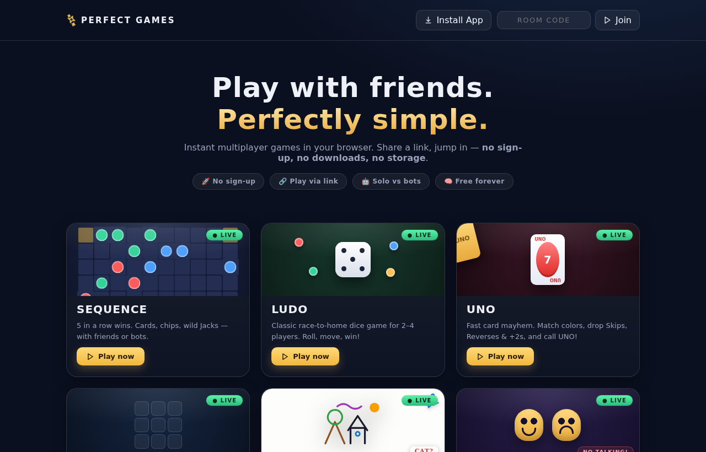
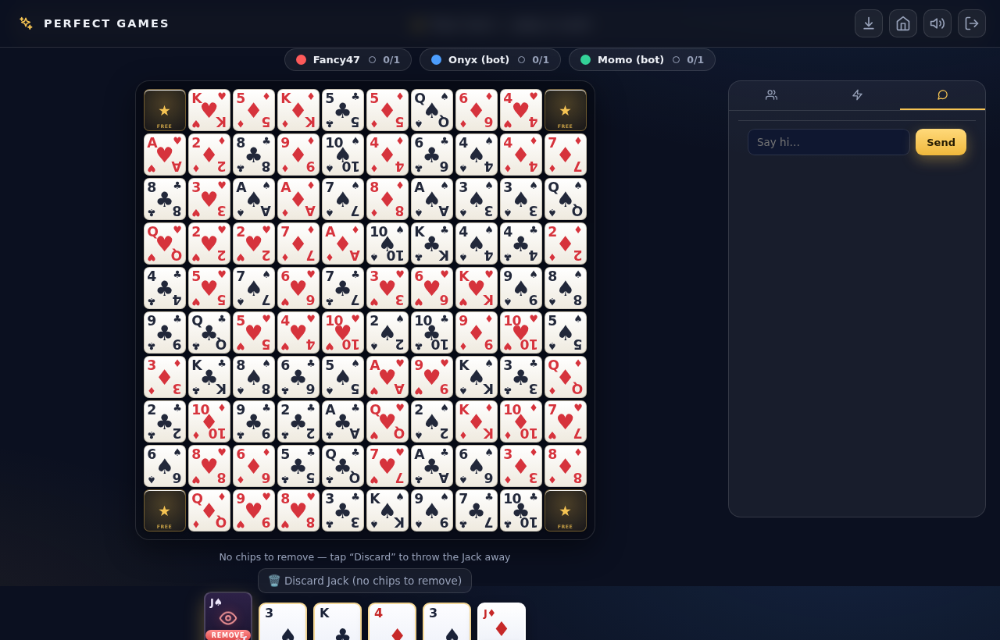
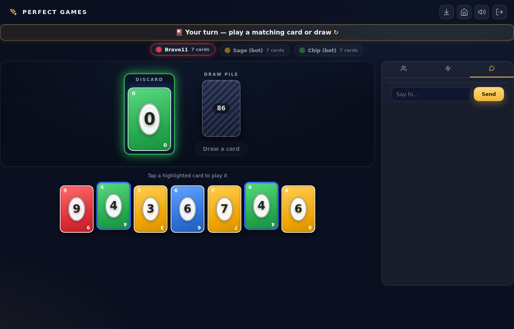
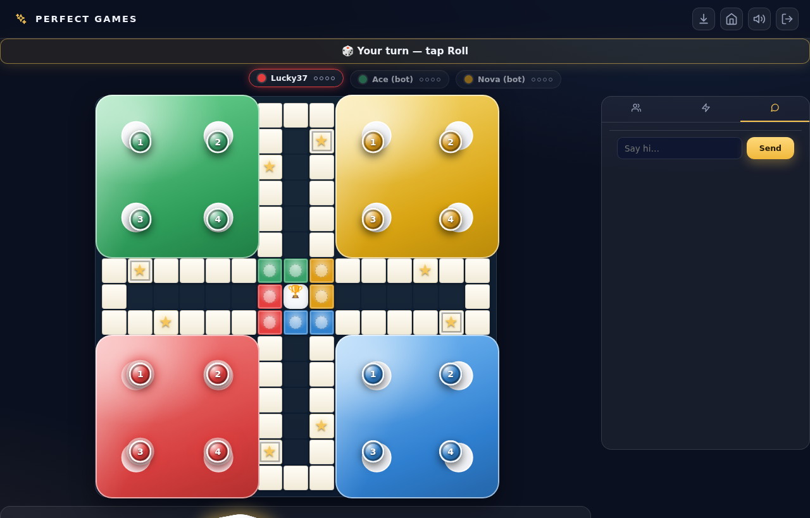
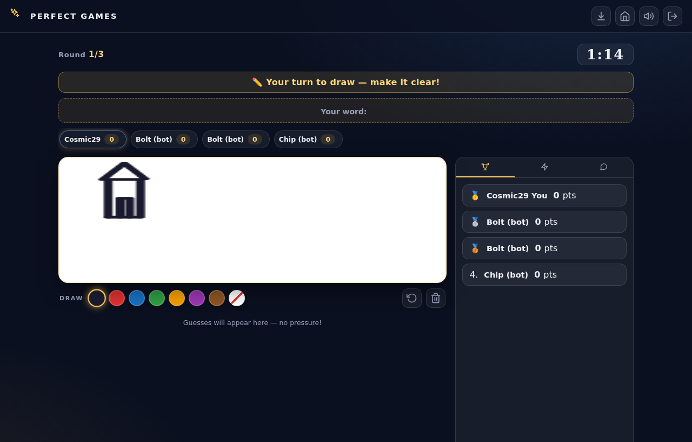
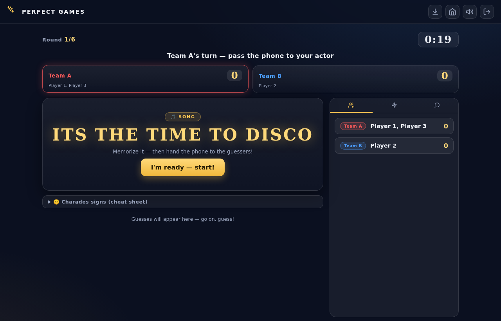
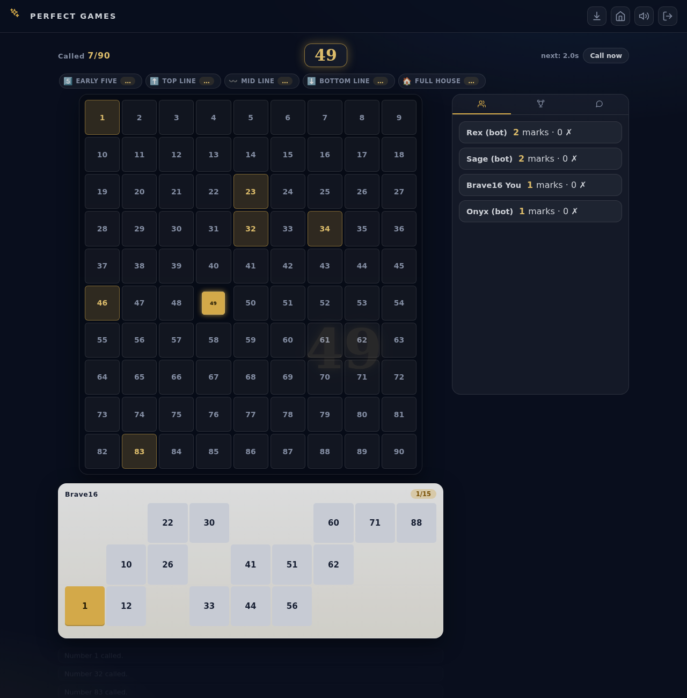

<div align="center">


**Seven classic multiplayer games that run in the browser — no sign-up, no downloads, no database.**

Sequence · Ludo · UNO · Tic-Tac-Toe · Draw & Guess · Dumb Charades · Tambola/Housie

[](https://nodejs.org)
[](https://expressjs.com)
[](https://github.com/websockets/ws)
[](https://developer.mozilla.org/en-US/docs/Web/API)
[](https://web.dev/progressive-web-apps/)
[](test/)
[](LICENSE)
[](https://github.com)

> Open any game, share a 6-letter room code (or a link), and friends join in one tap —
> on any device, with zero accounts. Rooms live **only in server memory** and vanish
> when the last person leaves. **Installable as a home-screen app** on phone or desktop.

</div>

---

## 📸 Screenshots

<table>
<tr>
<td width="50%"></td>
<td width="50%"></td>
</tr>
<tr>
<td align="center"><b>Home hub</b> — every game one tap away, installable as an app</td>
<td align="center"><b>Sequence</b> — 5-in-a-row card & chip battle</td>
</tr>
<tr>
<td width="50%"></td>
<td width="50%"></td>
</tr>
<tr>
<td align="center"><b>UNO</b> — colors, skips, reverses, +2s</td>
<td align="center"><b>Ludo</b> — classic race-to-home dice game</td>
</tr>
<tr>
<td width="50%"></td>
<td width="50%"></td>
</tr>
<tr>
<td align="center"><b>Draw & Guess</b> — live canvas sketching, guess the word</td>
<td align="center"><b>Dumb Charades</b> — act out Hindi movies & songs</td>
</tr>
<tr>
<td width="50%" colspan="2" align="center"></td>
</tr>
<tr>
<td colspan="2" align="center"><b>Tambola / Housie</b> — 90-ball caller with auto-generated tickets & live prize claims</td>
</tr>
</table>

---

## 🎮 The games

| Game | Route | Players | What it is |
|---|---|---|---|
| **Sequence** | `/sequence` | 2–6 | Play cards, place chips, first to two 5-in-a-rows wins. Wild & one-eyed Jacks. |
| **Ludo** | `/ludo` | 2–4 | Roll, capture, race home. 3D dice, smooth token glides. |
| **UNO** | `/uno` | 2–6 | Match colors & numbers, skip/reverse/+2/+4, call UNO! |
| **Tic-Tac-Toe** | `/ttt` | 2 | Instant classic with an unbeatable Pro bot. |
| **Draw & Guess** | `/drawguess` | 2–6 | Draw a secret word on a live canvas; fastest guessers score most. |
| **Dumb Charades** | `/charades` | 2 teams | 200+ Hindi movies & songs. Act it out, teammates guess. |
| **Tambola / Housie** | `/tambola` | 2–8+ | 90-ball caller, auto-generated tickets, Early Five · 3 Lines · Full House. |

Every game offers **three ways to play**:

- 🤖 **Play with Bots** — chill or pro bots fill the room instantly
- 👥 **Play with Friends → different devices** — room code + shareable link (with QR)
- 📱 **Play with Friends → same device** — hotseat / pass-and-play party mode

…plus live chat, rematch, reconnect-by-URL-token, synthesized sound effects, and an
**"Install App"** button so the whole hub can be added to a phone/desktop home screen
like a native app.

---

## ✨ Highlights worth reading

**1. Zero-friction multiplayer.** No accounts, no cookies, no localStorage. A room code
and a WebSocket are all that exist. Refresh the page and you rejoin automatically via a
token embedded in the URL — share only the token-free link with friends.

**2. Real-time by design.** One port serves HTTP **and** WebSockets (`/ws`), so it deploys
anywhere with zero proxy config — Docker, Render, Railway, a VPS behind Caddy, whatever.

**3. Server-authoritative with per-viewer privacy.** Every state push is built
per-player: your UNO hand, your Tambola ticket, the secret word, the charades title —
opponents' clients never receive data they shouldn't see (verified by tests).

**4. Pure-logic game engines.** `src/*.js` are dependency-free modules (state in, state
out, `now` injected for timers). Every rule — Sequence team alternation, UNO challenge
flow, Tambola claim validation with strikes, fuzzy Hindi-romanization matching for
charades — is unit-tested without a server or DOM.

**5. Procedural audio.** All sound effects are synthesized at runtime with the WebAudio
API (oscillators + filtered noise) — zero audio files, ~10 KB total.

**6. Canvas drawing, no libraries.** Draw & Guess streams normalized stroke coordinates
over WebSockets (low bandwidth, re-rendered crisply at any resolution), with dedup,
undo, and clear broadcast.

**7. Installable PWA.** A web app manifest + service worker let any browser "install"
Perfect Games to a home screen or desktop dock — standalone window, custom icon, offline
fallback screen — with zero impact on live WebSocket gameplay.

**8. Made for phones first.** Pointer events, touch-friendly targets, responsive boards
that refit to any screen, and no horizontal overflow — verified in a real mobile viewport.

---

## 🧰 Tech stack

### Backend
| | |
|---|---|
| **Node.js** (≥18) | HTTP server, static files, room lifecycle |
| **Express 4** | Routing + static serving |
| **ws** (WebSocket) | Real-time state sync, chat, drawing strokes, keep-alive pings |
| **In-memory rooms** | No database at all — `Map` of rooms, swept when empty |

### Frontend (zero frameworks, zero build step)
| | |
|---|---|
| **Vanilla JavaScript (ES6+)** | One small client per game + shared modules |
| **HTML5 Canvas 2D** | Draw & Guess board (DPR-aware, stroke streaming) |
| **Web Audio API** | Procedurally synthesized SFX — no audio files |
| **CSS3** | Custom properties (design tokens), Grid/Flexbox, keyframe animations, `clamp()` responsive type |
| **Inline SVG** | Feather-style icon set with brand glyphs (WhatsApp/Telegram share) |
| **Web App Manifest + Service Worker** | Installable PWA — home-screen icon, standalone window, offline fallback |

### Architecture notes
- **Clients** (`public/<game>/`): mode-select → bot/friends/hotseat modals → lobby
  (room-code hero + copy/QR) → game → rematch. Shared assets in `public/shared/`.
- **Engines** (`src/`): pure game rules — 7 games, each its own engine module.
- **Server** (`server.js`): rooms, seats, reconnects, bots scheduling, per-game timers
  (round clocks, auto number caller), per-viewer state builders.
- **PWA layer** (`public/manifest.webmanifest`, `public/sw.js`, `public/shared/pwa.js`):
  network-first service worker (never intercepts `/ws`), install-prompt handling shared
  by every page.

### Testing (1,100+ assertions, `npm test`)
| Suite | What it covers |
|---|---|
| `test/*-unit.js` | Engine rules for all 7 games (incl. 700+ Tambola ticket-shape checks) |
| `test/*-dom.js`, `seq-ui.js` | Client rendering via **jsdom** with a mocked WebSocket (state → DOM → sent messages) |
| `test/flow.js` | End-to-end against a live server (start it first) |
| CI | GitHub Actions runs `npm ci && npm test` on every push ([workflow](.github/workflows/ci.yml)) |

---

## 🚀 Getting started

```bash
npm install
npm start            # → http://localhost:8080
npm test             # 1,100+ assertions across all games
```

Open http://localhost:8080 → pick a game → **Play with Bots** (instant) or
**Play with Friends** (share the room code).

> Tip: open the same URL on your phone (same Wi-Fi) to feel the real multiplayer loop —
> and tap **Install App** in the header to add it to your home screen.

### Project structure

```
├── server.js              # Express + ws — rooms, reconnects, bots, timers
├── src/                   # Pure game engines (no I/O, unit-tested)
│   ├── sequence.js  ludo.js  uno.js  ttt.js
│   └── drawguess.js  charades.js  tambola.js
├── public/                # Zero-build frontends
│   ├── index.html         # Hub
│   ├── manifest.webmanifest, sw.js, offline.html   # PWA
│   ├── icons/              # App icons (all sizes + maskable + favicon)
│   ├── shared/             # icons.js, sound.js (WebAudio), pwa.js, vendor/qrcode.js
│   └── <game>/             # index.html + style.css + app.js per game
├── test/                  # Engine units + jsdom client suites (npm test)
├── docs/screenshots/      # README screenshots + banner
├── scripts/capture-screenshots.js  # Puppeteer script that (re)generates the screenshots
├── Dockerfile             # node:20-alpine, multi-stage ready
├── render.yaml            # One-click Render.com blueprint (free tier)
└── .github/workflows/ci.yml
```

---

## 📲 Installable as an app (PWA)

Perfect Games ships a full **Progressive Web App** setup — no app store needed:

- Tap **Install App** in the hub header (or the ⤓ icon in any game's header).
- **Android / desktop Chrome & Edge:** installs instantly to the home screen / app dock
  as a standalone window with its own icon.
- **iOS Safari:** tap **Share ⬆️ → Add to Home Screen** (iOS doesn't expose an automatic
  install prompt, so the button shows these steps instead).
- Works offline just enough to show a friendly reconnect screen — gameplay itself always
  needs a live connection, since rooms are real-time and server-side by design.

---

## ☁️ Deploy anywhere

The server honors `PORT` and serves HTTP + WS on one port — nothing else to configure.

- **Render** — push the repo → *New → Blueprint* (ships with `render.yaml`), or
  *New → Web Service → Public Git Repository* (runtime: Docker). Free tier friendly.
- **Docker** — `docker build -t perfect-games . && docker run -p 8080:8080 perfect-games`
- **Any VPS** — `npm install && npm start`, put Caddy/nginx in front for HTTPS.

> Free-tier note: rooms are in-memory, so a cold sleep simply clears open rooms —
> nothing to lose, nothing to migrate.

---

## 🤖 How this project was built (AI-assisted)

This project was developed **collaboratively with an AI coding assistant** — the
assistant implemented the engines, clients, tests and fixes from human requirements,
with the human reviewing behaviour, deciding scope, and testing every game in real
browsers before sign-off. Concretely:

1. **Human spec** — "a no-sign-up multiplayer Sequence, then Ludo/Uno/TTT", later
   Draw & Guess, Hindi-movie/song Charades, Tambola, and finally PWA installability.
2. **AI implemented** each pure-logic engine + server wiring + client UI + tests.
3. **Human feedback loops** drove refinements: token blink bugs, card-legibility
   redesigns, popup removals, music removal, game-type regressions, and full new games.
4. **AI verified** with headless-Chrome mobile walkthroughs, WebSocket end-to-end
   scripts and 1,100+ assertions; humans play-tested on real phones via temporary
   public tunnels.

Tools: Node.js, iterative prompting, Puppeteer-driven browser testing, Cloudflare quick
tunnels for live demos. Prompt snippets and iteration history are available on request.

---

## 📄 License

[MIT](LICENSE) © 2026 Perfect Games

*Sequence™ is a trademark of JAX Games / Buffalo Studios; this project is a fan-made
implementation for learning purposes, not affiliated with or endorsed by them.*
